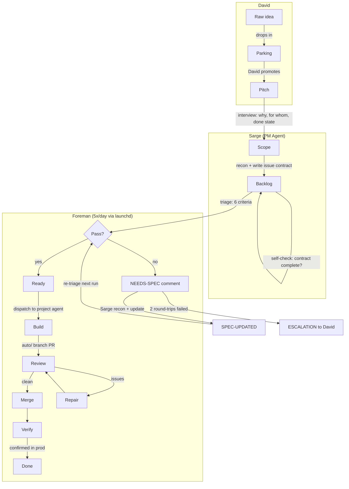
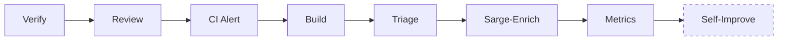

# Pipeline Workflow

Board: [Project #5](https://github.com/orgs/getqatalyst/projects/5)
Board config (project ID, status field ID, status option IDs): `~/Projects/.index.json` under each project's `board` field.

## Board Columns

| Column | Owner | Entry Gate |
|--------|-------|------------|
| Parking | David only | David drops raw ideas. Sarge never touches. |
| Pitch | Sarge | David promotes from Parking, or Intake creates directly |
| Scope | Sarge | Sarge interview done: goal, audience, done state captured |
| Backlog | Sarge | Sarge self-check: contract complete (Goal/AC/Context/OOS/Size/Files) |
| Ready | Foreman | Foreman triage pass: all 6 criteria met |
| Verify | Foreman | PR merged, checking in production |
| Done | Foreman | Verified in production, issue closed |

## Flow

## Foreman Daily Loop

Runs 5x/day via launchd (`config/schedule.plist`).

| Phase | Script | Model | Cap | What it does |
|-------|--------|-------|-----|-------------|
| Intake | `intake.sh` | Opus | -- | Interactive. Raw idea + repo -> spec'd issue in Pitch |
| Verify | `verify.sh` | -- | -- | Confirm merged PRs work in deployed environments |
| Review | `review.sh` | Opus | $10 | Review open PRs. Auto-merge clean `auto/` branches |
| Repair | `repair.sh` | -- | -- | Fix review findings on `auto/` branches |
| CI Alert | `ci-alert.sh` | -- | -- | Post-review: detect CI pile-ups across repos |
| Build | `build.sh` | Opus | $20 | Pick Ready tickets, dispatch to project agent, ship PR |
| Triage | `triage.sh` | Sonnet | $5 | Evaluate Scope + Backlog items against 6 criteria |
| Sarge-Enrich | `sarge-enrich.sh` | Opus | $10 | React to NEEDS-SPEC: recon codebase, update issue |
| Metrics | `collect-metrics.sh` | -- | -- | Parse daily logs into `metrics/YYYY-MM-DD.json` |
| Self-Improve | `self-improve.sh` | Opus | $10 | Every other day. Analyze metrics, tune prompts |

Mothballed: `pitch-to-scope.sh` (caused deadlocks). Manual only: `./orchestrator.sh pitch-to-scope`

## Safety Rails

- Builds in `/tmp/foreman-build-*` worktrees (never modify project dirs)
- Only `auto/` branches; never push to main
- CI must pass before merge
- 10 builds/day cap, 3 failures per ticket
- Auto-merge only for agent's own `auto/` PRs
- Stale PRs: merge conflicts >3 days -> close (issue -> Scope); no activity >7 days -> close (issue -> Ready)

## Cross-references

For content that used to live in this file but is now canonical elsewhere:
- **Triage criteria:** `sarge/agent-team-spec.md`
- **Comment protocol:** `sarge/agent-team-spec.md`
- **Issue contract format:** root `CLAUDE.md`
- **Eligible projects:** `~/Projects/.index.json`
- **Agent roles:** `sarge/agent-team-spec.md`
