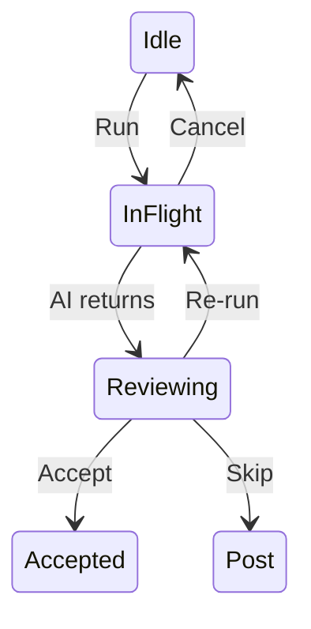

# /sketch — Tier 0 napkin-level visual (ASCII or Mermaid)

**Usage:** `/sketch [issue-number] [repo]` or `/sketch` with pasted issue text.

## Fidelity ladder position

```
/sketch → /wireframe → /schematic (opt) → /mockup → /prototype → production
  T0          T1               T2              T3          T4         T5
ASCII     Moqups HTML       annotation      styled HTML  +interactive
                            overlay
```

| Inherits from | Adds | Defers to next | Output URL pattern |
|---|---|---|---|
| Plain prose / scenario | Visual representation of IA at napkin level | Multi-state coverage, spatial fidelity, primitive refs → `/wireframe` | Inline in issue body (no separate file) |

## Purpose

Tier 0 of the design ladder. The **napkin sketch**: one state, IA only, zero commitment to layout details or aesthetics. Renders inline in GitHub markdown — no file, no auth, no click.

**Use to scope the problem before commitment.** Answers: "is this even the right problem to solve at all?" before any structural decision.

## What this tier OWNS

- **Information architecture** — what data + components exist; rough hierarchy

That's it. Everything else is deferred to `/wireframe`.

## What this tier DEFERS

- All states beyond the canonical one → `/wireframe`
- Spatial layout precision → `/wireframe`
- Component primitive selection → `/wireframe`
- Microcopy direction → `/wireframe`
- All aesthetics → `/mockup`
- All interactivity → `/prototype`

## Output forms

### Form A — ASCII box diagram (default)

For most UI sketches. Box-and-line in monospace, renders inline in any markdown context.

```
┌─ Surface name ─────────────────────────────────────────┐
│ [region label]            │  [region label]            │
│                           │                            │
│ [content placeholder]     │  [content placeholder]     │
│                           │                            │
├───────────────────────────┴────────────────────────────┤
│ [footer / action row]                                  │
└────────────────────────────────────────────────────────┘
```

### Form B — Mermaid flow / state diagram

For tickets where the question is "what's the flow" not "what's the layout." Renders inline in GitHub markdown.



Pick Form A when the question is spatial; Form B when the question is sequential.

## Workflow

### 1. Read

Fetch the issue body or pasted text. Identify:

- **The single most important state** — which one screen, in which state, is the canonical view?
- **The 3-5 information regions** — what does the user see?
- **The question being asked** — is this an IA decision, a flow decision, or both?

### 2. Produce

One block. Fenced code (for ASCII) or `mermaid` fenced block (for diagrams). Aim for ≤25 lines. Cells the issue can't ground stay as `(not stated)` — don't invent.

### 3. Place

- **XS / S ticket:** print inline in the issue body. The body IS the sketch.
- **M+ ticket:** print inline AS a quick-scan, then escalate to `/wireframe` for the full multi-state contract.

### 4. Decide whether to escalate

After scoping is settled, run `/wireframe` for the structural contract. If the ticket is truly XS (a copy change, a single button add), the sketch may be the only artifact needed.

## Output checklist

- [ ] One state, one canonical view — no multi-state coverage attempted
- [ ] ≤25 lines (ASCII) or ≤15 nodes (Mermaid)
- [ ] All region labels grounded in the issue — `(not stated)` where they aren't
- [ ] Renders inline in markdown (no separate file unless explicitly needed)

## When to escalate

- → `/wireframe` (T1) — the default next step for any M+ ticket once the sketch is approved
- Skip `/wireframe` only for truly trivial UI changes (single-button add, copy tweak, no new states)

## Related

- `/wireframe` — Tier 1 successor (Moqups-style HTML, multi-state)
- `/shape` — names "Visual" as the bottleneck that routes to `/sketch` → `/wireframe`
- `/flow` — produces T1d edge tables (verification contract); pair with `/sketch` when transitions matter as much as layout

## Anti-patterns

- **Don't sketch all states.** That's `/wireframe`'s job.
- **Don't sketch edge cases.** That's `/wireframe`'s job.
- **Don't sketch aesthetics.** That's `/mockup`'s job.
- **Don't commit a sketch to a `.html` file.** Sketches live inline. Wireframes are the first tier that gets a file.
